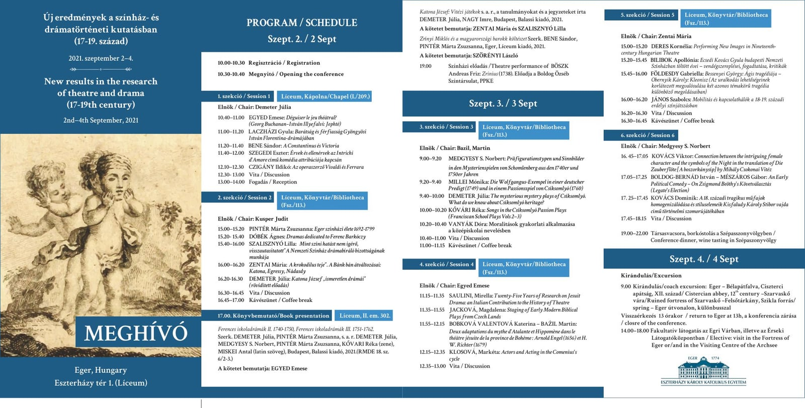
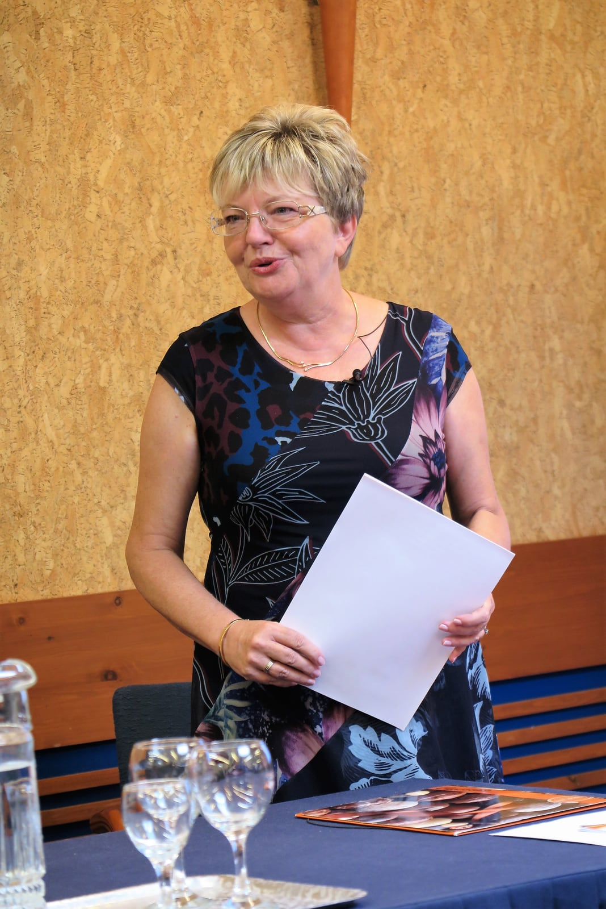
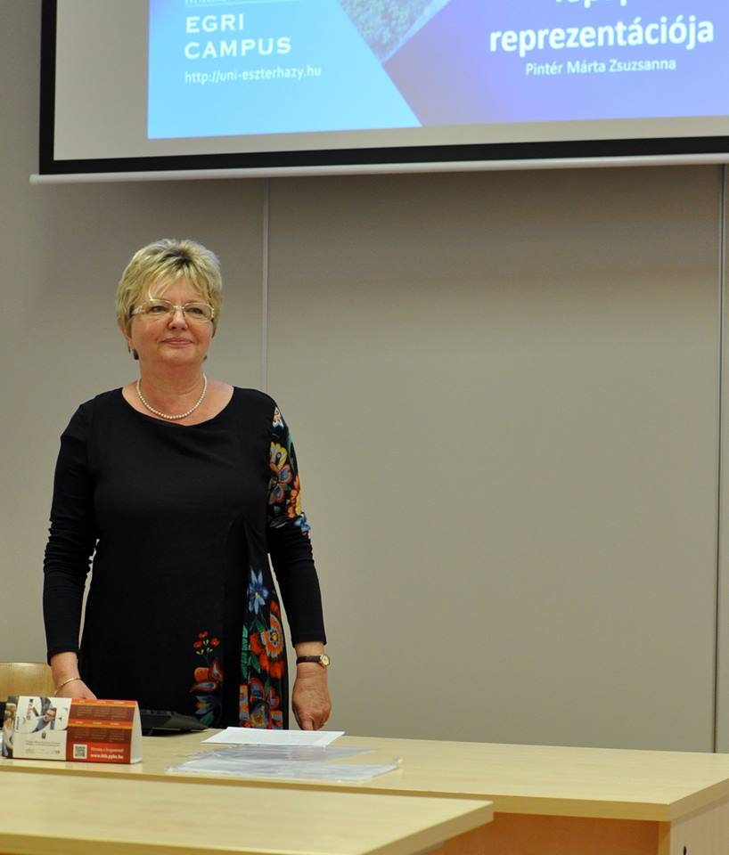
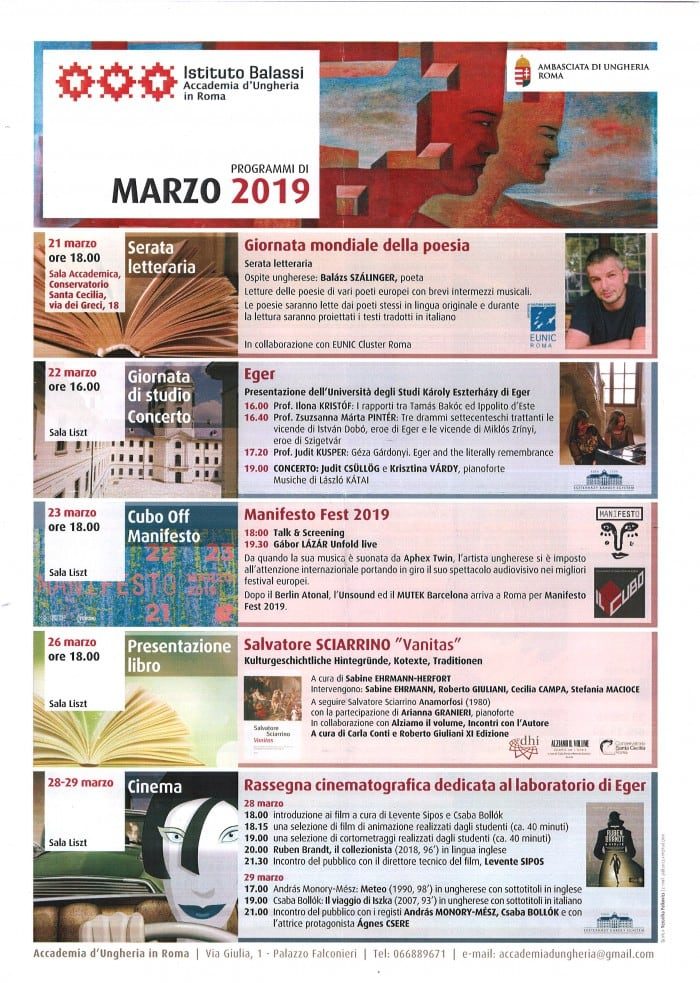
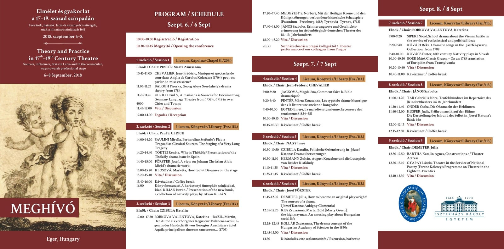
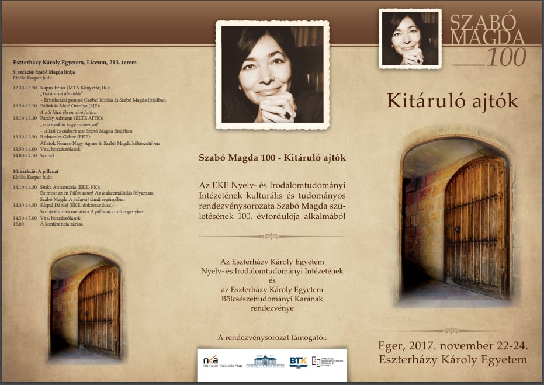
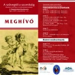

## Előadások

### Új eredmények a színház- és drámatörténeti kutatásban (17-19. század)

Konferencia meghívója és programja, Eger, Líceum, 2021. szeptember 2–4.

---

### Előadás az egri Zrínyi Miklós és a magyarországi barokk költészet című konferencián

A konferencia programfüzete letölthető itt: [Zrínyi füzet](/letoltesek/programfuzet-zrinyi-uj.pdf)

---

### Előadás a lelkiségtörténeti konferencián

A konferencia programja megtekinthető [ITT](/letoltesek/programkesz.pdf).

---

### Erőszak az irodalomban című konferencia, előadás

A konferencia programja megtekinthető [ITT](/letoltesek/fiszeke-2019progam.pdf).

---

### Előadás a Római Magyar Akadémián

---

### Elmélet és gyakorlat a 17–19. század színpadán

Konferencia meghívója és programja, Eger, 2018. szeptember 6–8.

---

### Szabó Magda konferencia és rendezvénysorozat a Magyar Nyelv- és Irodalomtudományi Intézetben

## X. Drámatörténeti Konferencia, Eger, 2015. szeptember 1–4.

### A konferencia végleges programja

A konferencia végleges programja letölthető [innen](http://dramakut.iti.mta.hu/wp-content/uploads/2014/01/Programfüzet-1..pdf).

**A konferencia titkárságának elérhetősége:**

- tel. (00 36) 36 520 475
- E –mail cím: [egerkonf@gmail.com](mailto:egerkonf@gmail.com)

A konferencia helyszíneinek [térképe](http://dramakut.iti.mta.hu/wp-content/uploads/2014/01/Eger-térképe.png).

---

### 2. körlevél

**X. Drámatörténeti Konferencia Eger**  
**A szövegtől a szcenikáig (Kutatások a korai dráma- és színháztörténet területén)**  
**Eger, 2015. szeptember 1–4.**

Kedves Kollégák!

Örömmel jelentjük, hogy több mint ötven előadó jelentkezett a dráma-kutatócsoport jubileumi konferenciájára, őszintén reméljük, hogy tartalmas programot sikerül összeállítanunk. Elkészült a konferencia programjának első változata, amit csatolva küldünk. Arra a kérjük az előadókat, hogy a magyar nyelvű előadásokhoz, ha módjukban áll, készítsenek idegen nyelvű prezentációt vagy összefoglalást, mivel a konferencia (ahogy az utóbbi években mindig) nemzetközi lesz.

A konferencia helyszíne az Eszterházy Károly Főiskola A épületének díszterme, illetve a könyvtár és a színházterem lesz. Az Egerbe való utazáshoz a 2-es metró Stadion állomásától induló volánbuszokat ajánljuk, minden óra 15 perckor expresszjárat indul Egerbe, de természetesen van közvetlen vonat is. A gépkocsival érkezőknek a főiskola B épülete előtti parkolóban tudunk parkolóhelyet biztosítani.

Ami a szállásokat illeti, minden szállás Eger központjában van, 5-10 percre a konferencia színhelyétől. Doktoranduszoknak, egyetemi hallgatóknak olcsóbb kollégiumi elhelyezést tudunk ajánlani a központban. A szállások ára 2500-8000 Ft között lesz, a pontos árakról és lehetőségekről (az NKA pályázatunk eredményének függvényében) június első hetében küldünk részletes tájékoztatást.

Szeretettel várunk az előadók mellett minden érdeklődőt, hallgatót is! A konferencia e-mail címe: egerkonf@gmail.com Az információk elérhetőek lesznek a http://dramakut.iti.mta.hu/ honlapon is.

Üdvözlettel,

a konferencia szervezőbizottsága  
Eger, 2015. május 20.

[PROGRAM](http://dramakut.iti.mta.hu/wp-content/uploads/2014/01/Eger-PROGRAMTERV.pdf)

---

### Figyelem!

**A RÉGI MAGYAR DRÁMATÖRTÉNETI KUTATÓCSOPORT 2015. SZEPTEMBER 1-4 KÖZÖTT TUDOMÁNYOS KONFERENCIÁT RENDEZ EGERBEN!**

A konferencia jelentkezési lapja és felhívása elérhető **itt** és az alábbi honlapon: <http://dramakut.iti.mta.hu/>

---

### A Régi Magyar Drámatörténeti Kutatócsoport és A Régi Magyar Színház sorozat

A [Régi Magyar Drámatörténeti Kutatócsoport](http://magyarszak.uni-miskolc.hu/kiadvanyok/drama2002/menu/kutcsop.htm) 1988 óta 3 évenként nemzetközi dráma- és színháztörténeti konferenciát szervez, főképp azért, hogy folyamatos legyen a diskurzus más diszciplinák művelőivel (zene-, szcenika-, művészettörténet, nyelvészet, néprajz, kulturális antropológia, történeti szociológia, stb.). A konferenciák szerkesztett és lektorált előadásait, a legfrissebb eredményeket tanulmánykötetekben tesszük közzé.

Az első 4 kötetet követően, 2000-ben hoztuk létre A Régi Magyar Színház sorozatot. (A sorozat második kötetét – e szakmai anyag lévén a legalkalmasabb születésnapi ajándék – a 70 éves Kilián Istvánnak ajánlottuk.) A kötetekben tematikusan rendezzük a tanulmányokat.

**A kötetek fejezetei az alábbi területeket fogják át:**

- a folklórral, a pszeudo-dramatikus játékokkal kimutatható színi kapcsolat;
- a színpadi zene (korabeli előadások vagy operák zenei anyagát is rekonstruálták a kutatók);
- a korabeli színpad, szcenika rekonstruálásának lehetőségei;
- közelítés a színházhoz a társművészetek, társműfajok felől;
- a korabeli sajtóanyag használata tudományos forrásként;
- drámafordítások, források;
- a „Szinkronvizsgálatok” c. fejezet átfogó és összehasonlító jellegű.

**Sorozatszerkesztő:** Demeter Júlia és Kilián István

**A sorozat eddig megjelent kötetei:**

1. [A magyar színház születése](http://klasszmagyar.hu/node/164)
2. [A magyar színjáték honi és európai gyökerei](http://klasszmagyar.hu/node/190)
3. [Színházvilág – világszínház. Tanulmányok a magyar és az európai dráma 18–19. századi történetéből](http://www.klasszmagyar.hu/node/250)
4. [Dráma – múlt, színház – jelen. Tanulmányok a dráma- és színháztörténet köréből](http://www.klasszmagyar.hu/node/682)
5. [(Dráma)szövegek metamorfózisa. Kontaktustörténetek](http://www.klasszmagyar.hu/node/691)

Szörényi László 1988 óta részvevője az egri drámatörténeti konferenciáknak. Az első ( ma már hozzáférhetetlen) konferenciakötetben megjelent tanulmányával köszöntjük 70. születésnapján.

*A Régi Magyar Dráma Kutatócsoport tagjai*

---

### Konferencia-felhívás, első körlevél

**A szövegtől a szcenikáig**  
**(Kutatások a korai dráma- és színháztörténet területén)**  
**Eger, 2015. szeptember 1–4.**

Az MTA Bölcsészettudományi Kutatóközpont Irodalomtudományi Intézetének régi magyar drámakutató-csoportja 2015. szept. 1–4. között rendezi meg háromévenként esedékes nemzetközi konferenciáját, mely a tizedik jubileumi alkalom lesz, ezért is – a határontúli színhelyek után – visszatérünk az első rendezvényeink színhelyére, Egerbe.

A választott cím arra utal, hogy a várt előadások témáját a drámaszöveg és a színpadi megvalósítás közötti út bármely állomása képezheti, a *korai* jelzőt pedig a 16–18. századra és a 19. század első felére értjük. A konferencia nyelve a magyaron kívül az angol, német, francia. Az előadások időtartama 20 perc lehet.

Jelentkezés 2015. március 15-ig az előadás címével és rövid (max. 250 szavas) rezüméjével az alábbi e-mail címen: [egerkonf@gmail.com](mailto:egerkonf@gmail.com)

A konferencia honlapja: [dramakut.iti.mta.hu](http://dramakut.iti.mta.hu/?page_id=38)

Kérjük, hogy saját intézményükben is terjesszék a konferencia hírét, minden érdeklődőt várunk!

**Rendező szervek:**

- Irodalomtudományi Intézet (MTA Bölcsészettudományi Kutatóközpont)
- Eszterházy Károly Főiskola, Eger

**Szervező bizottság:**

- Kilián István (a bizottság vezetője)
- Czibula Katalin
- Demeter Júlia
- Pintér Márta Zsuzsanna

Üdvözlettel:

A szervezőbizottság
