### Megjelent a Kiss Noémival közösen szerkeszett kötetünk

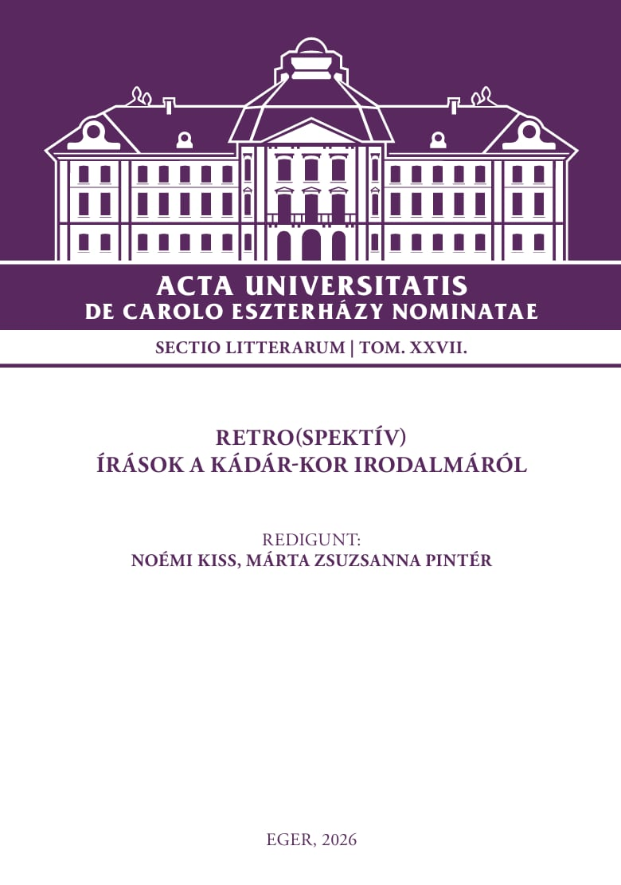

<https://uni-eszterhazy.hu/magyar/megjelent-a-sectio-litterarum-27-kotete>

A teljes kötet itt olvasható: [Letölthető dokumentum](/letoltesek/online-full-acta-litterarum-xxvii-irodalom-2026.pdf)

---

### Ferences iskoladrámák IV. kötet

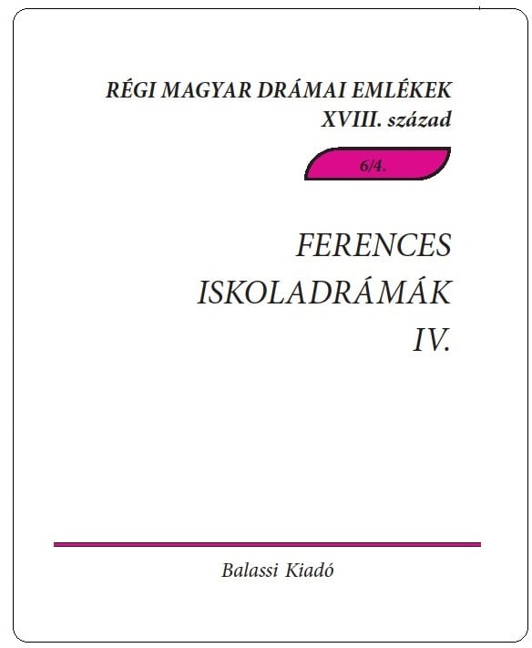

Demeter Júlia; Pintér Márta Zsuzsanna (szerk.), s. a. r. Demeter Júlia, Medgyesy S. Norbert, Pintér Márta Zsuzsanna, Kővari Réka (zene), Miskei Antal (latin szöveg)

Budapest, Balassi kiadó, 2022. 823 p. (RMDE 18. sz. 6/4.)

**A könyv teljes anyaga letölthető itt:** <http://real.mtak.hu/154730/>

**A könyv HTML, illetve epub formában is elérhető:**

- [HTML letöltése](/letoltesek/2022-11-28-ferences-iskoladramak-iv-html-egyben.zip)
- [Epub letöltés](/letoltesek/2022-11-28-ferences-iskoladramak-iv.epub)

---

### A történelmi dráma alakzatai a 16-18. századi magyar irodalomban

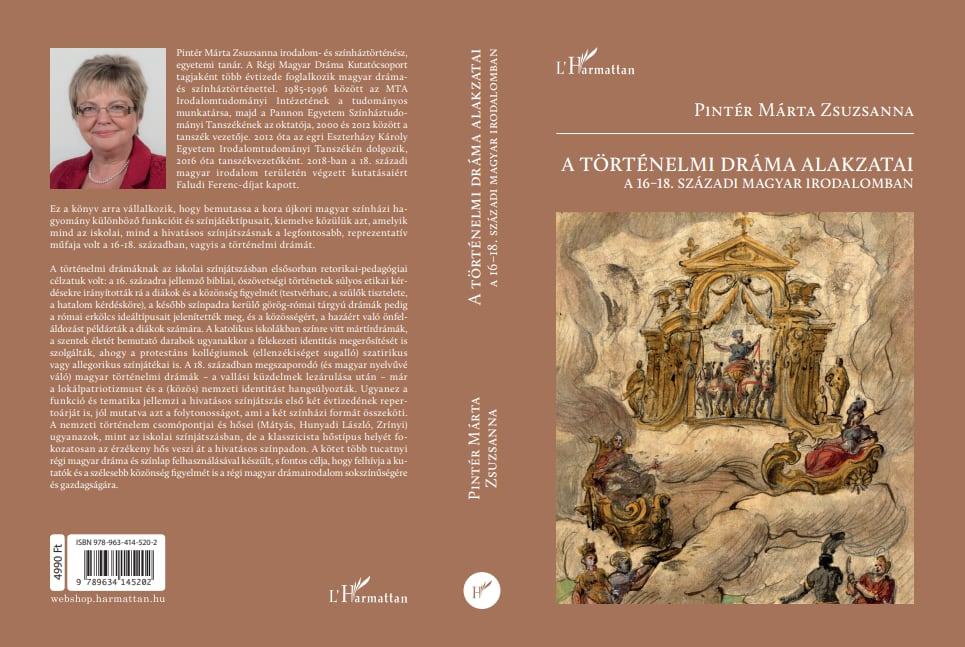

Bp., Uránia Ismeretterjesztő Alapítvány, L'Harmattan Kiadó, 2019, 446.p.

---

### Egy rejtőzködő irodalmár a 18. századból: Mártonfi József erdélyi püspök (1746–1815)

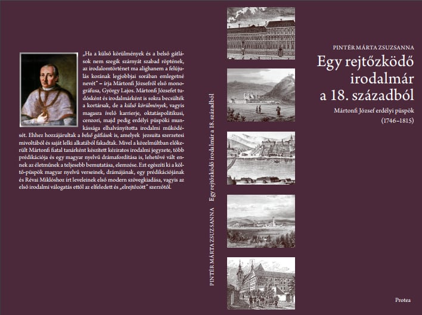

Bp., Protea Kulturális Egyesület, 2016. 176. p.

**A teljes szöveg letölthető innen:** <http://real.mtak.hu/53980/>

---

### Theátrum és literatúra

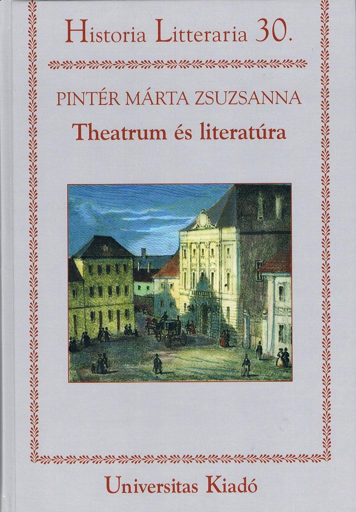

Bp., Universitas, 2014. [Historia Litteraria, 30.] 257. p.

---

### Le théatre dans le Royaume de Hongrie aux XVIIe et XVIIIe siècles

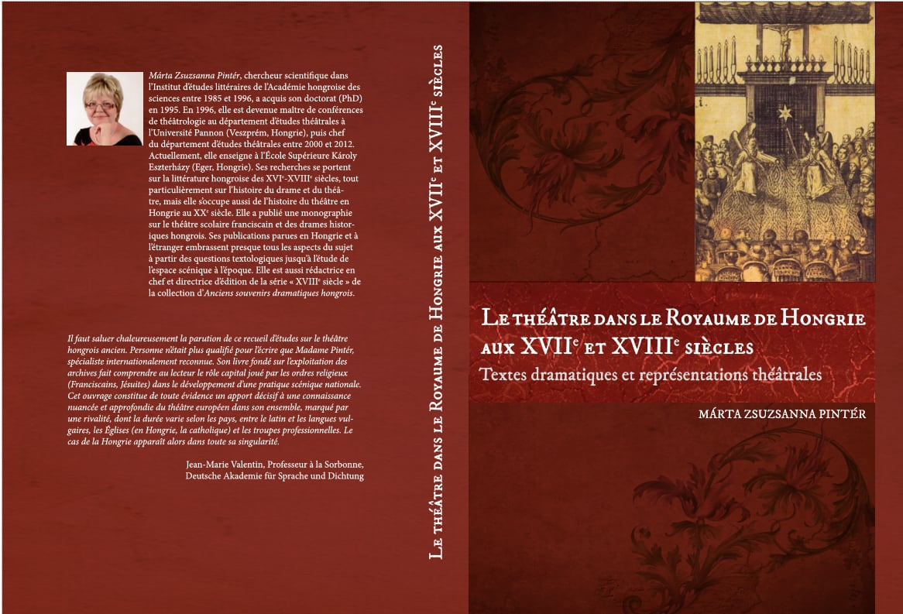

Nagyvárad, Partium Kiadó, 2015. 134. p.

---

### „ Jöszte poétának" Egy ismeretlen Csokonai-versgyűjtemény

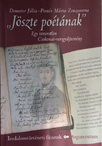

Demeter Júlia – Pintér Márta Zsuzsanna

Bp., Argumentum Kiadó, 2005. [Irodalomtörténet füzetek 156.] 337 p.

---

### Történelem a színpadon

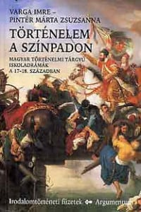

Varga Imre – Pintér Márta Zsuzsanna

Bp., Argumentum kiadó, 2000. [Irodalomtörténeti füzetek, 147.] 228. p.

---

### Ferences iskolai színjátszás a XVIII. században

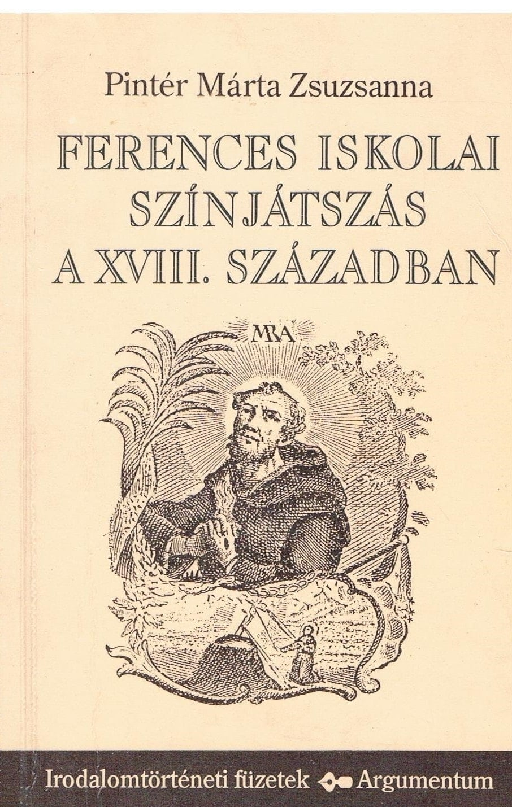

Bp., Argumentum Kiadó, l993. [Irodalomtörténeti füzetek, 132.] 163. p.

## Régi Magyar Drámai Emlékek 18 századi sorozata

### Kollégiumi drámagyűjtemények

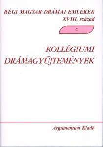

RMDE XVIII. század 7. szerk. Demeter Júlia, s.a.r. Czibula Katalin, Demeter Júlia, Pintér Márta Zsuzsanna, Bp., Argumentum Kiadó, 2015. 215-258, 811-1110.

---

### Ferences iskoladrámák 1.

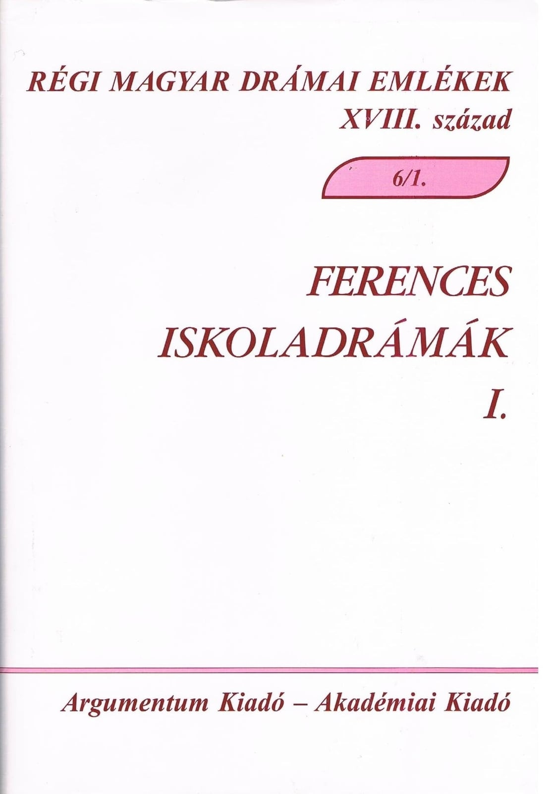

RMDE XVIII. század 6/1. szerk. Demeter Júlia – Kilián István - Pintér Márta Zsuzsanna, Bp. Argumentum Kiadó, 2009., 7- 20., 751-805.

---

### Piarista iskoladrámák I-II.

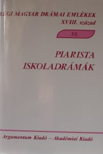

RMDE XVIII. század 5/1-2. szerk. Demeter Júlia – Kilián István - Pintér Márta Zsuzsanna, Bp. Argumentum kiadó, 2002., 2006. 2238 p.
