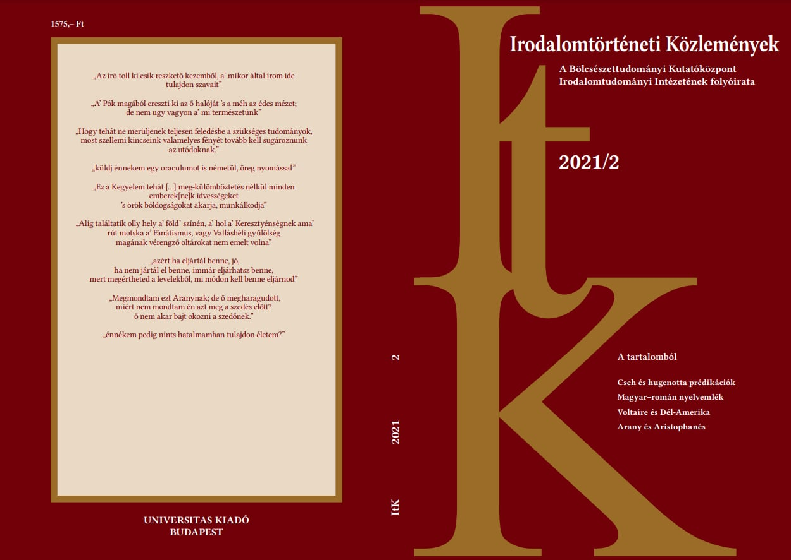
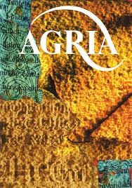

Tudományos műveim visszhangja:

### A monográfiámról megjelent újabb recenzió

Medgyesy S. Norbert: Pintér Márta Zsuzsanna: A történelmi dráma alakzatai a 16-18. századi magyar irodalomban, ItK (2021/2), 244-247. [Letöltés](/letoltesek/itk-2021-2-vagott.pdf)

---

### Megjelent egy recenzió a monográfiámról

Bartók István: Pintér Márta Zsuzsanna: A történelmi dráma alakzatai a 16-18. századi magyar irodalomban, Agria 50 (2020 tavasz), 261-265.

A teljes szöveg itt olvasható:

<http://www.agriafolyoirat.hu/pdf/Agria50_2020_tavasz.pdf>

## 1. Recenziók, kritikák

|  | Szerző/cím | Folyóirat (évf./szám) | Oldalszám (tól–ig) |
| --- | --- | --- | --- |
| 1. | Varga Imre: A ferences iskolai színjátszás a 18. században | Magyar Könyvszemle, 110(1994), 1. szám | 107-109. |
| 2. | Székely György: A ferences iskolai színjátszás a 18. században | ItK, 101(1997), 1–2. | 186-188. |
| 3. | Bence Erika: Történelem a színpadon | Hungarológiai Közlemények, Novi Sad, 2001. 1. | 108-116. |
| 4. | Demeter Júlia: Varga Imre, Pintér Márta Zsuzsanna: Történelem a színpadon. Magyar történelmi tárgyú iskoladrámák a 17–18. században. Budapest, Argumentum Kiadó, 2000, 228. l. (Irodalomtörténeti füzetek, 147) | ItK, 107(2003), 2–3. | 341-345. |
| 6. | Keszeg Anna: Dokumentum a költő és költészettanár Csokonairól | Korunk, 7(2007), 2. | 149-152. |
| 7. | Szilágyi Márton: Két újabb Csokonai-könyvről. Demeter Júlia – Pintér Márta Zsuzsanna: „Jöszte poétának”; Lukács László: Csokonai a néphagyományban | Irodalomtörténet, 88(2007), 2. | 257-263. |
| 8. | Posta Anna: Pintér Márta Zsuzsanna: Theatrum és literatúra | Agria, 9(2015) 3. (ősz) | 260-269. |
| 9. | Bitskey István: A magyarországi katolikus tanintézmények színjátszásának forrásai és irodalma 1800-ig | ItK, 97(1993), 3. | 447-449. |
| 10. | Szelestei Nagy László: A magyarországi katolikus tanintézmények színjátszásának forrásai és irodalma 1800-ig | Magyar Könyvszemle, 109(1993), 2. | 244-245. |
| 11. | Kaposi Krisztina: Pintér Márta Zsuzsanna: Theatrum és literatúra | ItK, 116(2016), 4. | 536-539. |
| 12 | Dóbé Ágnes: Pintér Márta Zsuzsanna: Egy rejtőzködő deákos költő | ItK, 117(2017), 4. 560-562. | 620-622. |

## 2. A szerkesztett kötetekről készült recenziók

|  | Szerző/cím | Folyóirat (évf./szám) | Oldalszám (tól–ig) |
| --- | --- | --- | --- |
| 1. | László Szilas S.J.: Schule, Bildung, Theater | Archivum Historicum Societatis Iesu , 1992. (Róma) | 230-232. |
| 2. | Mózes Huba: Az iskolai színjáték és a népi dramatikus hagyományok | Magyar Könyvszemle, 110(1994), 1. | 109-111. |
| 3. | Monok István: Iskoladráma és folklór - Az iskolai színjáték és a népi dramatikus hagyományok | ItK 98(1994), 4. | 576-578. |
| 4. | Dékány Endre: A dráma folyamatosság – folyamatos drámaiság | Új Ember, 57(2001), 6. | 17. |
| 5. | Tar Gabriella-Nóra: Piarista iskoladrámák 2. | Keresztény Szó, 19(2008), 1. | 24. |
| 6. | Nagy Szilvia: Ferences iskoladrámák, I, Csíksomlyói passiójátékok 1721–1739 | Itk 114(2010), 3. | 270-277. |
| 7. | Brutovszky Gabriella: Szín-Játék-Költészet. Tanulmányok a 80 éves Kilián István tiszteletére | ItK 118(2014), 4. | 577-581. |
| 8. | Hegedűs Béla: Édes érzékenység | http://reciti.hu/2014/2398 |  |
| 9. | Róth András Lajos: Szigethy Gyula Mihály és a Kollégiumi drámagyűjtemények | Lustra, 3(2016), 2. (Székelyudvarhely) | 26-28. |

## 3. A szerkesztett kötetekben megjelent tanulmányokról készült recenziók

|  |  |  |  |
| --- | --- | --- | --- |
| 1. | Jakab Gábor, Csíksomlyói passiójátékok a XVIII. századból | Hitvallás. A Győri Egyházmegye Lapja, 4(2003). 10. (www.hitvallás.hu) | 40-41. |
| 2. | Czibula Katalin: „Nap, Hold és csillagok, velem zokogjatok” | Távlatok, 2004, 12. | 538-541. |
| 3. | Havas László: „Hol vagy István király? A Szent István hagyomány évszázadai | ItK 111(2007), 1-3. | 297-304. |
| 4. | Jan Okon: Europejskie zwiazki dawnego teatru szkolnego i europejska wspólnota dawnich kalendarzy | Ruch Literacki, 2007.1. | 107-110. |
| 5. | Hász-Fehér Katalin: Tanulmányok a magyar nyelv ügyének 18. századi történetéből | ItK 112(2008), 1. 112-119. | 112-119. |
