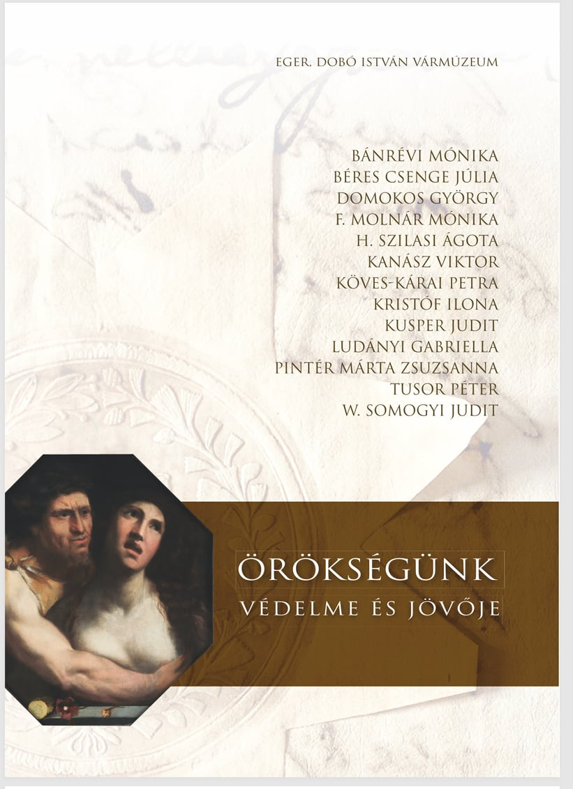
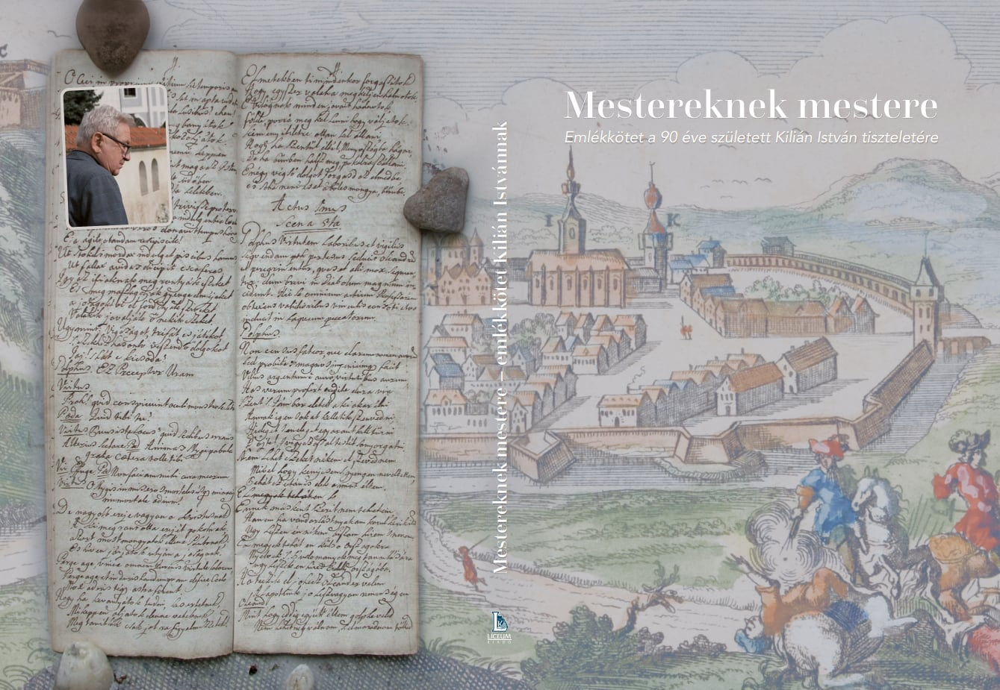
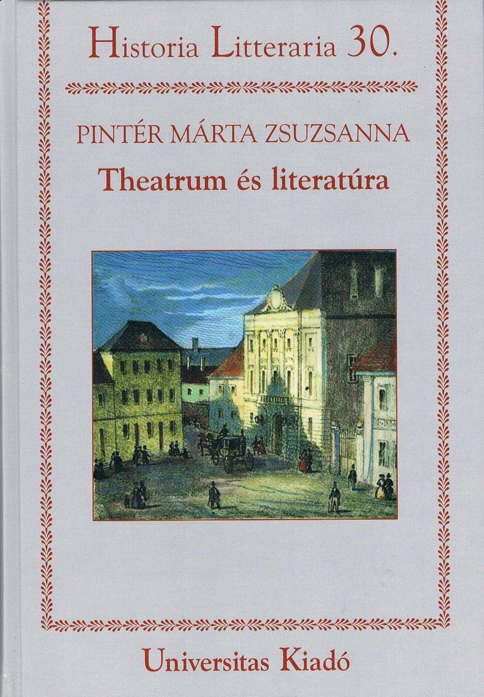
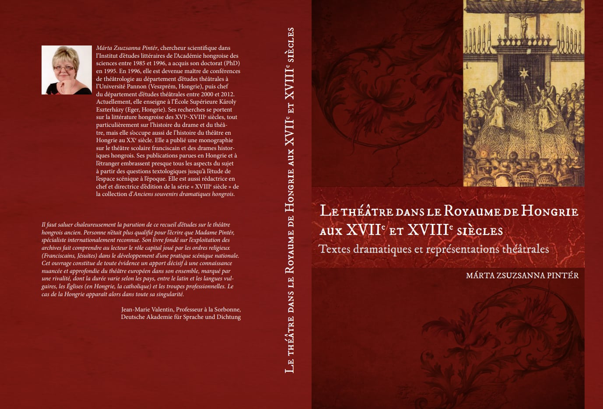
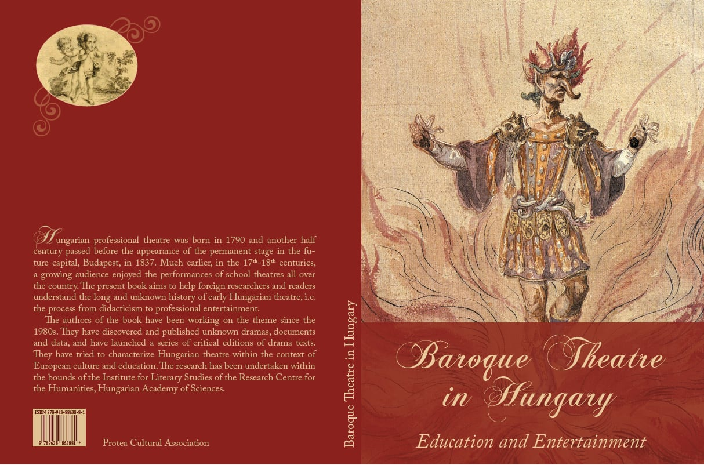
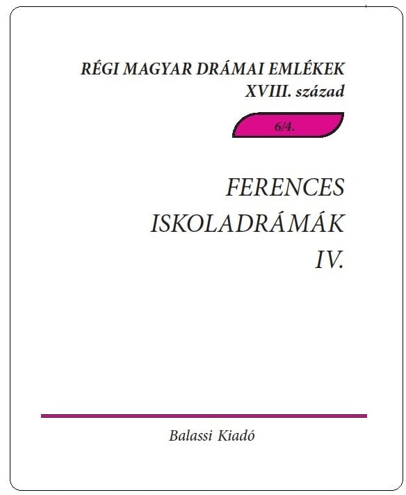
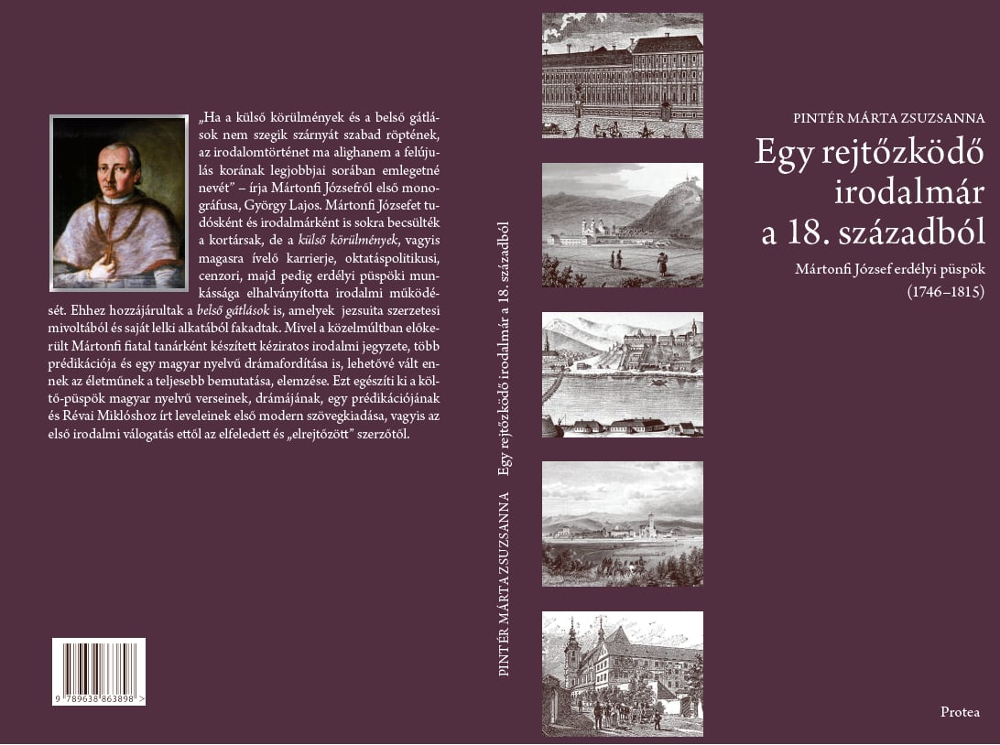

Az ingyenesen, online hozzáférhető könyvek listája:

### Itália öröksége Egerben

Megjelent új tanulmányom az *Itália öröksége Egerben* című kötetben. A címe: *Itáliai hatások az egri színházi életben 1810-ig*. A tanulmány szövege itt olvasható: [Letölthető dokumentum](/letoltesek/oroksegunk-6-pinter-egyben.pdf)

---

### Kilián István-emlékkötet

Megjelent a tavalyi konferencia kötete, amellyel a 90 éve született Kilián Istvánra, mesterünkre emlékezünk:

A kötet tartalma PDF-ben: [Letölthető dokumentum](/letoltesek/kilian-kotet-3.pdf)

---

### Theatrum és literatúra

Universitas, 2014

Letöltés PDF formátumban: [Letölthető dokumentum](/letoltesek/pdfsam-merge.pdf)

---

### Le théâtre dans le Royaume de Hongrie aux XVIIe et XVIIIe siècles

Partium, 2015

Letöltés PDF formátumban: [Letölthető dokumentum](/letoltesek/pmzs-v.pdf)

---

### Baroque Theatre in Hungary

*Education and Entertainment*

Edited by Júlia Demeter

Protea Cultural Association  
Budapest 2015

Letöltés PDF formátumban: [Letölthető dokumentum](/letoltesek/baroquetheatre-vagojeles-beliv-uj.pdf)

---

### Ferences iskoladrámák IV. kötet

Demeter Júlia; Pintér Márta Zsuzsanna (szerk.), s. a. r. Demeter Júlia, Medgyesy S. Norbert, Pintér Márta Zsuzsanna, Kővari Réka (zene), Miskei Antal (latin szöveg)

Budapest, Balassi kiadó, 2022. 823 p. (RMDE 18. sz. 6/4.)

A könyv teljes anyaga letölthető PDF, HTML és EPUB formátumban is

- **PDF:** http://real.mtak.hu/154730/
- **HTML:** [A letöltéshez kattintson ide!](/letoltesek/2022-11-28-ferences-iskoladramak-iv-html-egyben.zip)
- **EPUB:** [A letöltséhez kattintson ide!](/letoltesek/2022-11-28-ferences-iskoladramak-iv.epub)

---

### Egy rejtőzködő irodalmár a 18. századból: Mártonfi József erdélyi püspök (1746-1815)

Protea Kulturális Egyesület 2016

Letölthető PDF formátumban: [Letölthető dokumentum](/letoltesek/martonfi-vagojeles-beliv-u.pdf)
