**Publikációim listája: [MTMT](https://vm.mtmt.hu//search/slist.php?nwi=1&inited=1&ty_on=1&url_on=1&cite_type=2&orderby=3D1a&location=mtmt&stn=1&AuthorID=10008092)**

**Megjelent a Mercs Istvánnal közösen szerkesztett kötetünk és benne a tanulmányom:**

Mitológiai témák a XVII. századi erdélyi színjátékokban: Felvinczi György és a Comico-Tragoedia 219-233.

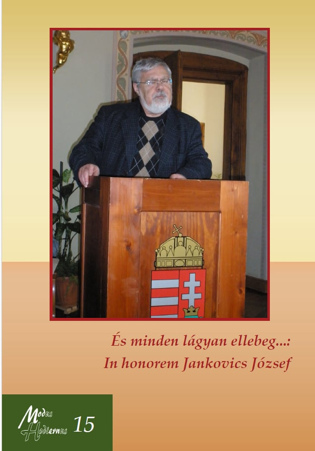

A tanulmány szövege itt olvasható: [Letölthető dokumentum](/letoltesek/jankovics-tanulmany.pdf)

**Megjelent legújabb tanulmányom: Az eperjesi iskolai színjátszás, 141-156.**

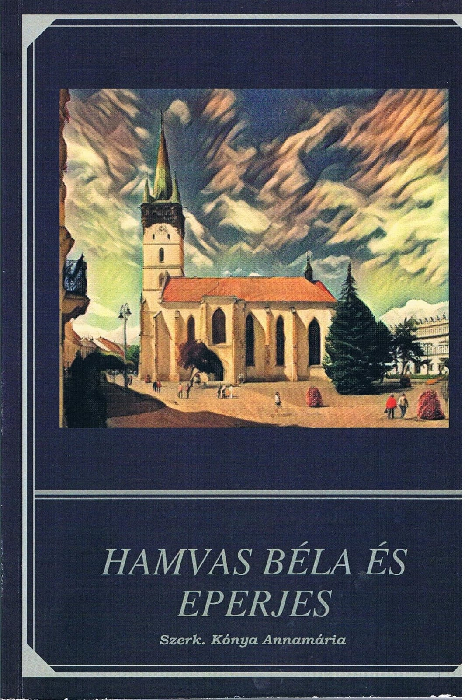

**A kötetben megjelent tanulmányom:**  
**A verses barokk színjáték poétikája 289-312.**

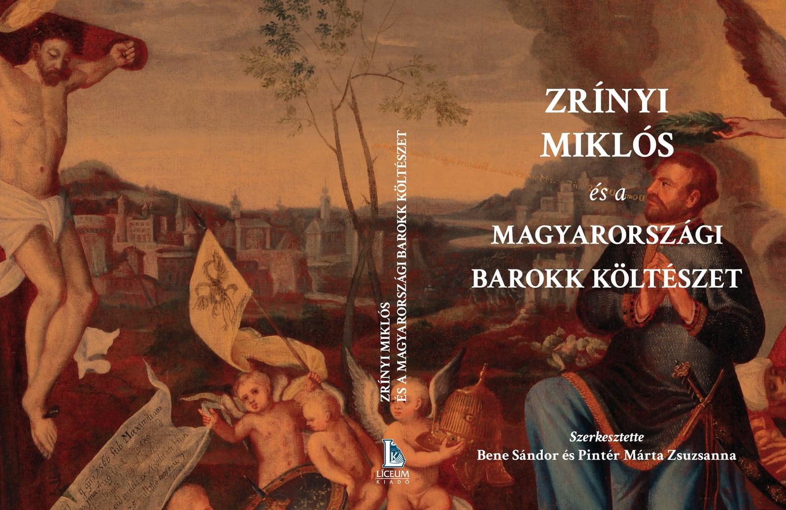

**A kötetben megjelent tanulmányom:**

[Deutschsprachige historische Dramen mit ungarischen Themen aus den 1790er Jahren](https://m2.mtmt.hu/gui2/?mode=browse&params=publication;31965306), 41-53.

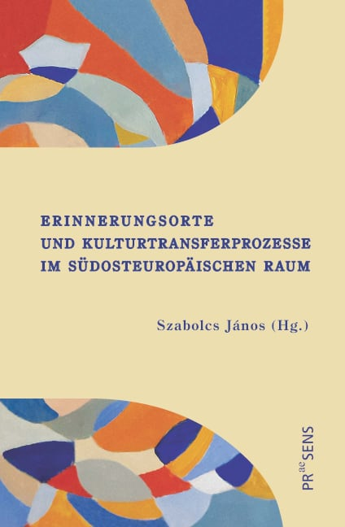

Újonnan megjelent tanulmányom:

Eszterházy Károly színházi reprezentációja. In: Személyek, intézmények szerepe a hívek lelkiségének alakításában a 17–18. században (szerkesztette Szelestei N. László), MTA–PPKE Barokk Irodalom és Lelkiség Kutatócsoport, Budapest, 2019, 101-118.

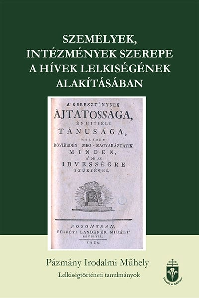

<https://btk.ppke.hu/uploads/articles/2008470/file/Lelktan24.pdf>

A kötet szerkesztői Czibula Katalin, Demeter Júlia és Pintér Márta Zsuzsanna, a kötetben megjelent tanulmányom: Les types du drame historique dans la litterature ancienne hongroise, 111-122.

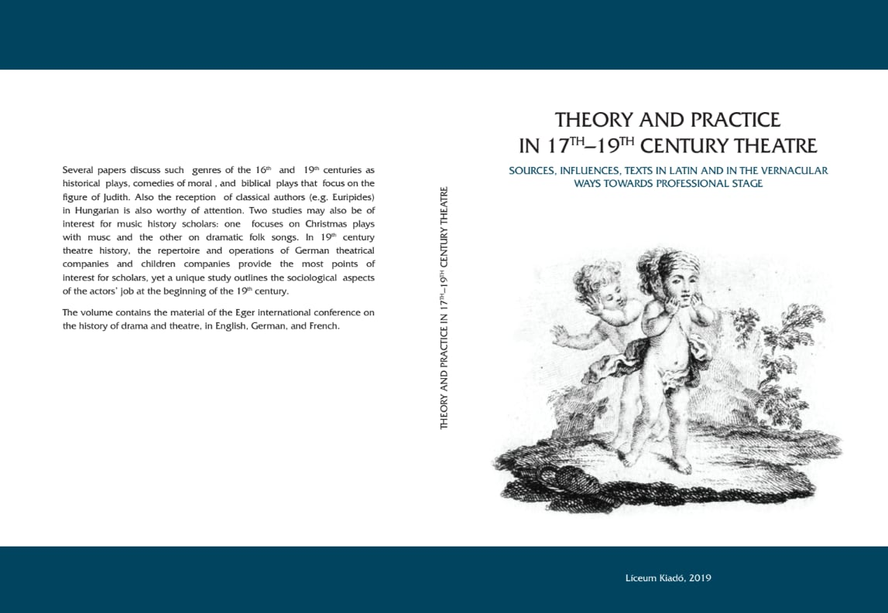

A Vigília című folyóiratban megjelent tanulmányom: A megkínzott Test, 500-506.

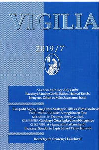

A kötetben megjelent tanulmányom: A felekezeti identitás megjelenése a protestáns iskolai színjátszásban, 159-174.

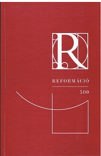

 A Szcenáriumban megjelent recenzióm: A karácsonyi ünnepkör színjátékai Magyarországon,99-104.

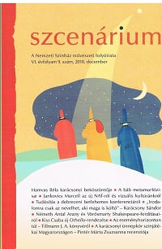

Az Irodalomtörténeti Közlemények 2019/1-es számában megjelent recenzióm A karácsonyi ünnepkör színjátékai Magyarországon

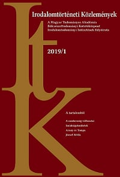

**Megjelent a Színjátéka sorozat első két kötete:** (**A képre kattintva megtekinthető a kötetek ismertetője**)

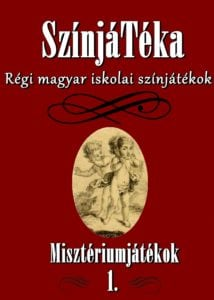

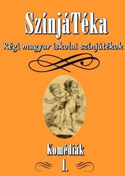

**A kötet szerkesztői: Czibula Katalin, Demeter Júlia, Pintér Márta Zsuzsanna A kötetben megjelent tanulmányom: *A színházi függönyök ikonológiai programja a 18. század végén,* I. kötet, 82-96.**

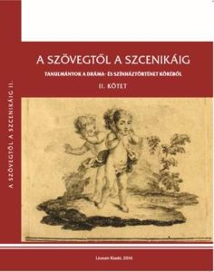

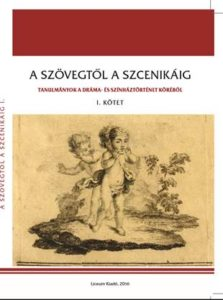

**A folyóiratban megjelent tanulmányom: *The Reception of Hroswitha of Gandersheim in Hungary,* 77-95.**

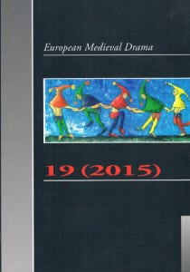

**A kötetben megjelent tanulmányom: *Jezsuita fordítói műhelyek a 18. század második felében,* 94-109.**

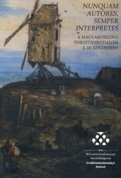

### Baroque Theatre in Hungary: Education and Entertainment Edited by Júlia Demeter, Budapest, Protea Cultural Association, 2015.
### Benne: Two of the Earliest Hungarian Dramas from the 16th Century: The Three Christian Maids end The Story of The Three Youths, 9-22.
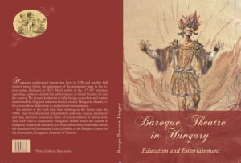

### A kötetben megjelent tanulmányom:
**Színjátékok a pápai pálos gimnáziumban a 18. században, 271-290.**

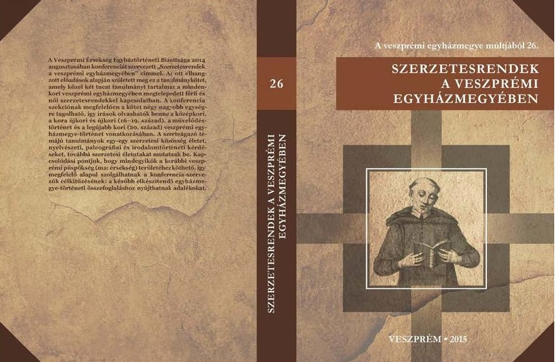

### A folyóiratban megjelent tanulmányom:
**Spettacoli in onore della famiglia Rákóczi nei secoli XII-XVIII, 43-51.**

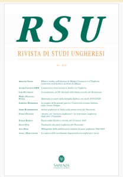

### A kötetben szereplő tanulmányom:
**Ünnep és teatralitás. Esterházy Pál nádorrá választása, 459-476.**

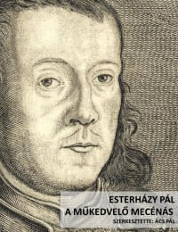

A kötet tartalomjegyzéke és az előszó elolvasható itt.

### Tóthfalusy József és a losonci drámagyűjtemény, 263-274.

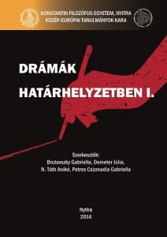

### Gárdonyi a színházi diskurzusban, 350-378.
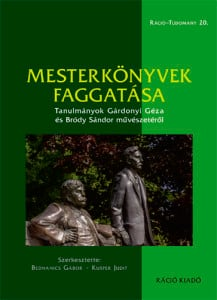

### A Sándor-kódex irodalmi programja - Hrostwitha Dulcitiusának magyar recepciója 277-293.
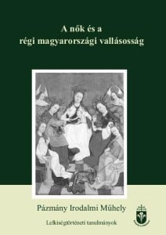

A kötet letölthető innen!

### Megjelent a SzínjáTéka sorozat első kötete:

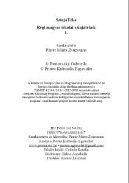

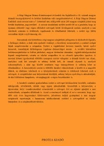

### Megjelent az "Édes érzékenység" Tanulmányok Ányos Pálról című kötet (Gondolat-PE MFTK, Bp.-Veszprém, 2014, pp. 220. ISBN 9789636933869)
### A kötet szerkesztése mellett két tanulmányom szerepel a kötetben: Három dokumentum Ányos Pál iskolaéveihez és Ányos Pál korabeli recenziójához: érzékenyjáték - Ányos Pál egyik versével
### „Édes érzékenység" Tanulmányok Ányos Pálról
### Hegedüs Béla recenziója: <https://mtabtk.videotorium.hu/hu/recordings/9612>
### (forrás: www.reciti.hu)
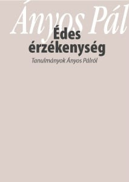

### A magyar színház születése
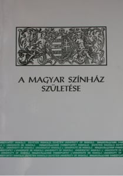

### A magyar színjáték honi és európai gyökerei
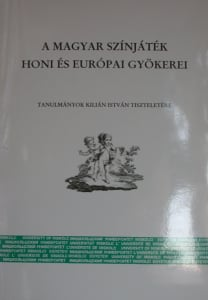

### Dráma – múlt, színház – jelen. Tanulmányok a dráma- és színháztörténet köréből
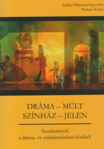

### (Dráma)szövegek metamorfózisa. Kontaktustörténetek I-II.
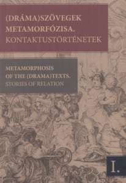

### Színházvilág – világszínház
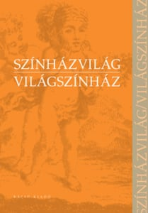

### Tanulmányok a magyar nyelv ügyének 18. századi történetéből
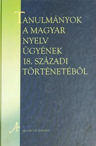

### Szövegkönyv
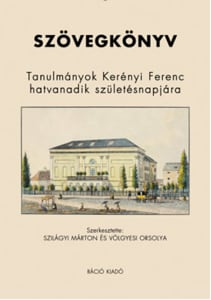

### Festett egek - A történelem, mint valóság és mint allegória – hermeneutika a barokk színpadon
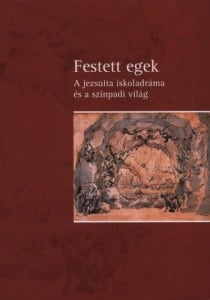

### Europejskie związki dawnego teatru szkolnego i europejska wspólnota dawnych kalendarzy - Les mystères de la Passion de Csíksomlyó: la tradition médiévale et la forme baroque au XVIIIe siècle
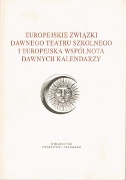

### Szín – játék – költészet - A passiójátékok és a politika a 20. században
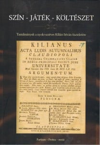
